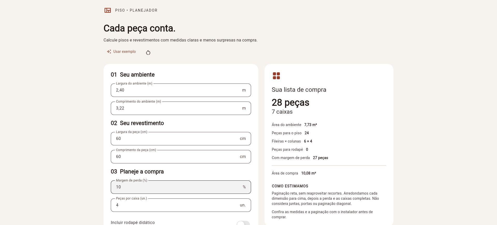

# Floor Calculator


[](https://github.com/kleberandrade/floor-calculator-flutter/actions/workflows/flutter.yml)
[](LICENSE)

A Flutter classroom app by **Kleber de Oliveira Andrade** for estimating rectangular floor and wall-covering quantities. The Portuguese interface separates room dimensions in **meters** from tile dimensions in **centimeters**, explains rounding, and shows a shopping list alongside the form on wide screens.



## Run locally

Verified toolchain: Flutter **3.50.0 stable**, Dart **3.14.0**, Chrome **157** on macOS. The manifest requires Dart ≥3.14 and Flutter ≥3.50; use the verified version for reproducible results. No account, API keys, server, or database is required. Install Flutter 3.50.0 from the [official SDK archive](https://docs.flutter.dev/install/archive), put its `bin` on your PATH and confirm `flutter --version`; the old shared SDK does not satisfy the updated manifest.

```sh
git clone https://github.com/kleberandrade/floor-calculator-flutter.git
cd floor-calculator-flutter
flutter pub get
flutter run -d chrome
```

Select **Usar exemplo**, then **Calcular quantidade**. The sample uses a 2.40 × 3.22 m room, 60 × 60 cm tiles, 10% waste and 4 pieces per box. It produces **24 floor pieces → 27 with waste → 7 boxes / 28 purchased pieces / 10.08 m²**. The actual room area is 7.728 m² (displayed as 7.73 m²).

Use Tab/Shift+Tab to navigate, Enter in the last field to calculate, and **Limpar formulário** to reset. Decimal commas and points are accepted; thousands separators, negative values, zero dimensions, non-finite numbers and fractional box sizes are rejected. Editing any value clears the old result so it cannot be mistaken for a current estimate. On narrow screens, scroll below the form to see the result.

## Calculation and assumptions

1. Convert tile dimensions from centimeters to meters.
2. Round up each room-to-tile dimension, then multiply the rows and columns. Tiles retain their entered orientation. There is no automatic rotation or reuse of cuts.
3. Optionally add the original **didactic skirting estimate**, one extra piece per row plus one per column. This preserves the lesson's `rows + columns` rule, **not** a perimeter/height based skirting design. Disabled by default.
4. Apply waste (0–100%) and round up to whole pieces.
5. Round up to full boxes and calculate purchased tile area.

The original lesson's 2.40 × 3.22 m example still gives 24 floor pieces and 10 additional skirting pieces (34 total / 12.24 m²) when waste is zero and boxes contain one piece. No grout joints, openings, diagonal layouts, labor or prices are modeled. Confirm layout with an installer before buying. Dimensions are limited to 100,000 in their displayed unit, box size to 10,000 and the base estimate to ten million pieces to reject accidental extreme inputs.

## Domain glossary

- **Room area**: the actual rectangular surface, width × length in m².
- **Floor pieces**: complete rows × columns before extra allowances.
- **Required pieces**: floor pieces plus optional didactic skirting, then waste, rounded up.
- **Purchased pieces**: full boxes × pieces per box; may exceed required pieces.
- **Purchase area**: purchased pieces × one tile's area, not the room area.

## Architecture

- `lib/domain/estimate.dart`: immutable validated result, pure calculation, localized decimal parser. No Flutter dependency.
- `lib/pages/calculator_page.dart`: form state, validation, focus, example and reset. State is local to the screen.
- `lib/widgets/estimate_card.dart`: empty/result presentation and calculation assumptions.
- `lib/core/theme_app.dart`: Material 3 typography, colors, fields and cards.
- `test/`: conversion, rounding, invalid input, small dimensions and responsive form interaction tests.

There is deliberately **no persistence or external service**. Reloading closes the current calculation. The old application had no stored data, so no storage migration is necessary and no artificial storage/service layer was added.

## Validate and build

```sh
dart format --output=none --set-exit-if-changed lib test
flutter analyze
flutter test --coverage
flutter build web --no-wasm-dry-run
```

The committed GitHub workflow `.github/workflows/flutter.yml` runs these checks on `master` pushes and pull requests using Flutter 3.50.0. The CI badge reports the actual workflow status; no coverage badge is inferred from a local run. All direct packages are at their latest releases (`material_ui` 1.11.1, `cupertino_icons` 2.0.0, `flutter_lints` 6.0.0). All transitives use their newest SDK-resolvable version. Flutter itself pins `material_color_utilities` 0.13.0 and `test_api` 0.7.14, below registry Latest; no override bypasses those constraints. See the [full dependency audit](docs/dependencies.md) and [machine-readable snapshot](docs/dependencies.json).

For a built Web preview:

```sh
python3 -m http.server 8734 --bind 127.0.0.1 --directory build/web
# Open http://127.0.0.1:8734
```

Android uses Gradle 9.5.0, Android Gradle Plugin 9.3.1, the current Flutter plugin DSL and Java 17 compilation and Flutter-provided SDK levels. An Android SDK/JDK is required; run `flutter doctor` and personally review any outstanding Android licenses before building. Release signing is still the template's debug signing; configure your own signing before distribution. Application ID remains `com.example.floor_calculator`.

iOS uses the current scene lifecycle and minimum iOS **15** for the installed Xcode 27.2. Bundle ID remains `com.example.floorCalculator`. A physical-device release requires your own signing configuration. See [validation notes](docs/validation.md) for actual platform results and limitations; no physical-device validation is claimed.

## Migration from the 2020 lesson

The project now uses Dart 3 null safety, immutable calculation results, current Flutter controls and the standalone `material_ui` package for Material 3. The old mutable models/controller/helpers and modal result are replaced by the focused domain, local form state and inline result card. **Important correction:** the old screen labeled tile sizes as centimeters but the controller divided them directly into meter dimensions; tile fields now actually accept centimeters. Enter `60`, not `0.6`, for a 60 cm tile. The original test supplied meters and masked that UI bug.

No framework change, SDK-global upgrade, remote backend, telemetry or data migration was introduced. The MIT notice originally embedded in this README is retained verbatim in [LICENSE](LICENSE).

## Lesson and credits

Created for the Mobile Programming course by Kleber de Oliveira Andrade, 2020.

- [Original Portuguese tutorial / classroom notes](https://medium.com/@kleberandrade/criando-um-aplicativo-em-flutter-para-calcular-a-quantidade-de-pisos-por-m%C2%B2-dac30b5b5027).
- [Portuguese tutorial revision](docs/medium-update.pt-BR.md), with current code, an original cover, fresh screenshots and five classroom challenges. [Editorial status and asset provenance](docs/medium-publishing.md).
- The original lesson credits professor **Aloísio Delpupo** for the flooring explanation and **Código Fonte TV** for its TDD introduction; those credits remain applicable.
- [Suragch's image tutorial](https://medium.com/@suragch/how-to-include-images-in-your-flutter-app-863889fc0b29) remains an optional third-party learning reference; its content was not edited or copied.
- The tutorial ends with five new exercises: optional box pricing, actual skirting dimensions, tile orientation comparison, grout joints and copying an accessible estimate summary. Each includes acceptance criteria; these are proposed extensions, not implemented app features. Validation, example loading and clear are already implemented.

UI uses Flutter's Material icons (and the official `cupertino_icons` 2.0.0 font for the adaptive iOS control) and code-native components; no unlicensed photos or third-party article screenshots were added. [Real browser screenshots](docs/screenshots/) document the running app.
