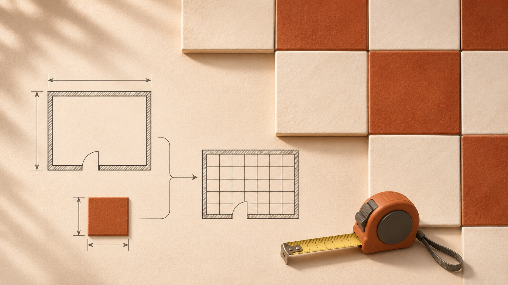
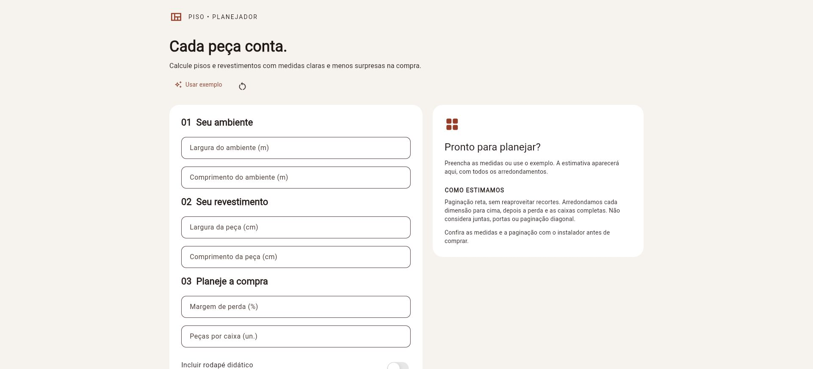
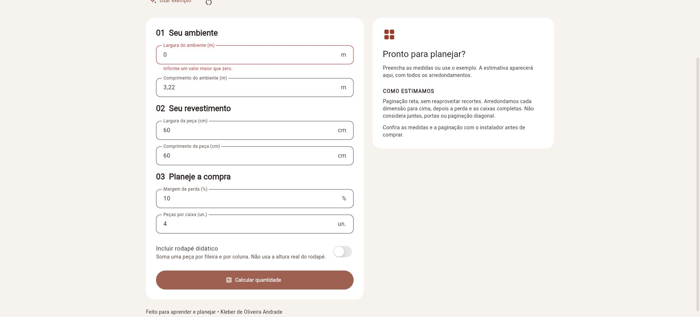
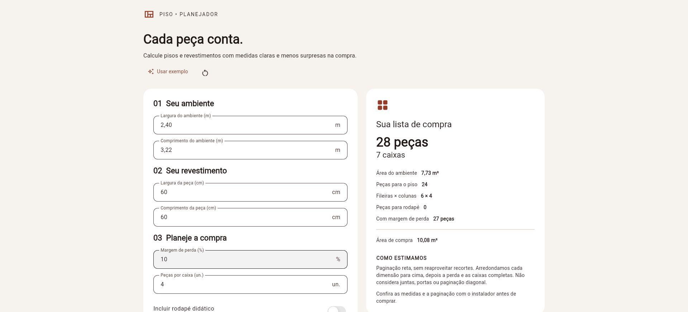
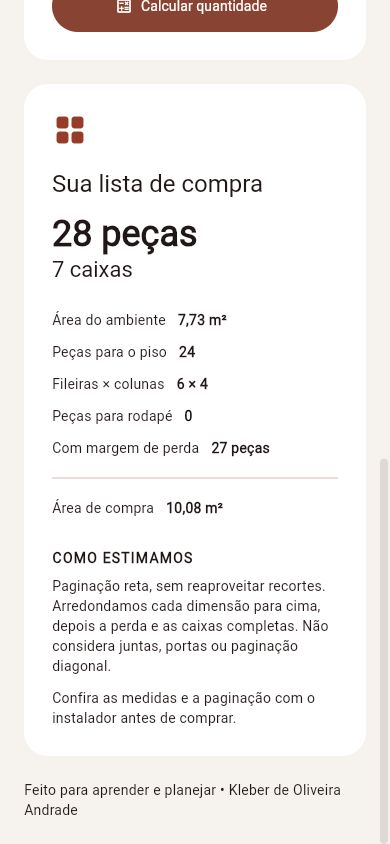

# Criando um aplicativo em Flutter para calcular a quantidade de pisos por m²

Notas de aula do professor Kleber de Oliveira Andrade



*Ilustração conceitual criada com IA para esta revisão. As capturas do aplicativo ao longo da aula são reais.*

Quantas peças precisamos comprar para revestir um cômodo? A resposta depende das medidas, da orientação das peças, dos recortes, da perda e da forma como o material é vendido. Nesta aula vamos transformar essas decisões em regras explícitas e testáveis em Dart, depois apresentar o resultado em um formulário Flutter.

A proposta continua sendo um projeto de estudo, com uma tela e sem banco de dados. Vamos usar Flutter 3.50.0, Dart 3.14.0 e Material 3, separar o cálculo da interface, aceitar vírgula decimal e mostrar exatamente de onde saem as quantidades. A atualização preserva o propósito e a autoria da aula publicada em 2020.

## 1. Experimente antes de alterar

Instale o Flutter 3.50.0 estável e confira flutter --version. Abra um terminal e execute os comandos abaixo. O Chrome permite acompanhar a aula sem configurar um emulador. Para Android e iOS, instale também as ferramentas nativas indicadas no README do projeto.

```sh
git clone https://github.com/kleberandrade/floor-calculator-flutter.git
cd floor-calculator-flutter
flutter pub get
flutter run -d chrome
```

Clique em “Usar exemplo” e depois em “Calcular quantidade”. Observe primeiro os campos e as unidades; em seguida, confira os números do cartão. Você pode usar Tab e Shift+Tab para navegar e Enter no último campo para calcular. O botão de limpeza esvazia todos os campos e remove a estimativa anterior.



*Formulário real no Chrome com Flutter 3.50: ambiente em metros, peças em centímetros e compra em caixas.*

O exemplo utiliza ambiente de 2,40 × 3,22 m, peças de 60 × 60 cm, perda de 10% e quatro peças por caixa. O rodapé didático começa desligado. O resultado esperado é 24 peças para o piso, 27 peças após a margem e sete caixas, ou 28 peças compradas. A área do ambiente e a área de compra são números diferentes.

## 2. Entenda a regra antes de programar

Primeiro convertemos centímetros para metros: 60 cm = 0,60 m. Misturar unidades é um erro fácil de esconder: o teste antigo informava 0,6 enquanto a tela pedia centímetros. Na versão atual, digite 60 para representar uma peça de 60 cm; a conversão acontece uma única vez no domínio.

```text
colunas = ceil(2,40 / 0,60) = 4
fileiras = ceil(3,22 / 0,60) = 6
peças para o piso = 4 × 6 = 24
com perda de 10% = ceil(24 × 1,10) = 27
caixas = ceil(27 / 4) = 7
peças compradas = 7 × 4 = 28
área real = 2,40 × 3,22 = 7,728 m²
área de compra = 28 × 0,60 × 0,60 = 10,08 m²
```

Por que arredondar cada dimensão? Uma fileira incompleta ainda ocupa uma posição na paginação. Dividir apenas a área do ambiente pela área de uma peça seria outro modelo de cálculo. Nossa regra usa paginação reta, orientação fixa e não reaproveita recortes. Ela não considera juntas, portas ou assentamento diagonal; essas hipóteses aparecem no próprio resultado.

O arredondamento de compra vem por último. Arredondar as caixas antes de aplicar a perda pode produzir outra quantidade. A perda não é um número “mágico” escondido no código: é um campo visível de 0 a 100%. Confira a margem e a paginação com o instalador antes de comprar.

A opção “Incluir rodapé didático” preserva a regra da aula original: acrescentar uma peça por fileira e uma por coluna. Com o exemplo, são 6 + 4 = 10 peças adicionais; sem perda e com uma peça por caixa, chegamos a 34 peças e 12,24 m². Essa regra não conhece a altura do rodapé e não substitui um dimensionamento por perímetro e cortes. Por isso ela é opcional e está identificada como didática.

## 3. Atualize dependências sem misturar versões

Este é o pubspec.yaml usado no projeto. O arquivo pubspec.lock fica versionado para reproduzir a resolução. Flutter e flutter_test acompanham o SDK; material_ui contém os componentes atuais do Material, cupertino_icons fornece a fonte do controle adaptativo e flutter_lints ajuda a manter o código consistente.

```yaml
name: floor_calculator
description: Calculate floor and wall-covering quantities with explicit units and rounding.
publish_to: none
version: 2.0.0+2
environment:
  sdk: '>=3.14.0 <4.0.0'
  flutter: '>=3.50.0'
dependencies:
  cupertino_icons: ^2.0.0
  flutter:
    sdk: flutter
  material_ui: ^1.11.1
dev_dependencies:
  flutter_test:
    sdk: flutter
  flutter_lints: ^6.0.0
flutter:
  uses-material-design: true
```

No Flutter 3.50, importamos os componentes com package:material_ui/material_ui.dart, conforme a migração oficial do Flutter. Não basta atualizar o número do SDK e manter imports descontinuados. A aplicação continua em Flutter; não há troca de framework.

```dart
import 'package:material_ui/material_ui.dart';
```

Todos os pacotes estão na versão mais recente que o Flutter 3.50.0 estável consegue resolver. Dois transitivos continuam fixados pelo SDK: material_color_utilities 0.13.0 e test_api 0.7.14. Existem versões 0.13.1 e 0.7.15 no registro, mas forçá-las com dependency_overrides esconderia a restrição do SDK. Para conferir a diferença entre versão publicada e versão compatível, execute flutter pub outdated --show-all. O relatório completo está em docs/dependencies.md.

## 4. Separe o cálculo da tela

Uma decisão deve ter um lugar claro. Em lib/domain/estimate.dart ficam a conversão do texto, as regras de validade e o cálculo. Esse arquivo não importa Flutter: podemos testar seus resultados sem abrir uma tela. A página guarda o estado do formulário; o cartão apenas apresenta uma Estimate válida. Não precisamos duplicar largura e comprimento em dois modelos mutáveis nem criar um gerenciador global para uma única tela.

```text
lib/
  domain/estimate.dart          → parsing e cálculo puro
  pages/calculator_page.dart    → campos, foco e estado local
  widgets/estimate_card.dart    → estado vazio e resultado
  core/theme_app.dart           → tema Material 3
  main.dart                    → entrada do aplicativo
test/
  estimate_test.dart            → regras de cálculo
  widget_test.dart              → interação do formulário
```

Antes de implementar uma regra, escreva o resultado esperado e veja o teste falhar pelo motivo certo. O arquivo abaixo verifica o exemplo original, perdas e caixas, arredondamento, limites e vírgula decimal. Se você estiver acompanhando a partir do repositório pronto, os testes já passam: altere uma regra de propósito, observe a falha e desfaça a alteração. Não confunda esse exercício com o histórico de implementação.

Arquivo completo: test/estimate_test.dart.

```dart
import 'package:flutter_test/flutter_test.dart';
import 'package:floor_calculator/domain/estimate.dart';

void main() {
  Estimate run({
    double width = 2.4,
    double length = 3.22,
    double tileWidth = 60,
    double tileLength = 60,
    double waste = 0,
    int perBox = 1,
    bool skirting = false,
  }) => Estimate.calculate(
    roomWidth: width,
    roomLength: length,
    tileWidthCm: tileWidth,
    tileLengthCm: tileLength,
    wastePercent: waste,
    piecesPerBox: perBox,
    includeSkirting: skirting,
  );
  test('converts centimeters and preserves row-by-row classroom example', () {
    final result = run(skirting: true);
    expect(result.columns, 4);
    expect(result.rows, 6);
    expect(result.floorPieces, 24);
    expect(result.skirtingPieces, 10);
    expect(result.requiredPieces, 34);
    expect(result.purchaseArea, closeTo(12.24, 1e-9));
    expect(result.roomArea, closeTo(7.728, 1e-9));
  });
  test('rounds waste then full boxes upward', () {
    final result = run(waste: 10, perBox: 4);
    expect(result.requiredPieces, 27);
    expect(result.boxes, 7);
    expect(result.purchasePieces, 28);
    expect(result.purchaseArea, closeTo(10.08, 1e-9));
  });
  test('does not add a phantom row for floating point multiples', () {
    expect(
      run(width: 2.1, length: 2.1, tileWidth: 30, tileLength: 30).floorPieces,
      49,
    );
  });
  test('a tiny positive room still needs one piece', () {
    expect(run(width: 1e-12, length: 1e-12).floorPieces, 1);
  });
  test('rejects invalid and impractically large quantities', () {
    for (final value in [0.0, -1.0, double.nan, double.infinity, 1e12]) {
      expect(() => run(width: value), throwsArgumentError);
      expect(() => run(tileWidth: value), throwsArgumentError);
    }
    expect(() => run(waste: -1), throwsArgumentError);
    expect(() => run(waste: 101), throwsArgumentError);
    expect(() => run(perBox: 0), throwsArgumentError);
    expect(() => run(tileWidth: 0.000001), throwsArgumentError);
    expect(() => run(tileWidth: 1e-320), throwsArgumentError);
  });
  test(
    'parses localized decimals without silently replacing invalid input',
    () {
      expect(parseNumber(' 2,40 '), 2.4);
      for (final value in ['', 'abc', 'NaN', 'Infinity', '1.000,50']) {
        expect(parseNumber(value), isNull);
      }
    },
  );
}
```

Agora leia a implementação completa em lib/domain/estimate.dart. O construtor privado evita criar resultados parciais. A fábrica recebe dimensões válidas, calcula todas as quantidades e devolve um objeto imutável. Não existe um resultado com área indefinida ou número de caixas ainda por preencher.

```dart
/// Accept decimal comma or point, never grouping or non-finite values.
double? parseNumber(String text) {
  final normalized = text.trim().replaceAll(',', '.');
  if (!RegExp(r'^\d+(\.\d+)?$').hasMatch(normalized)) return null;
  final value = double.tryParse(normalized);
  return value != null && value.isFinite ? value : null;
}

/// Immutable estimate for an aligned rectangular layout, without cut reuse.
class Estimate {
  const Estimate._(
    this.columns,
    this.rows,
    this.skirtingPieces,
    this.requiredPieces,
    this.boxes,
    this.purchasePieces,
    this.roomArea,
    this.tileArea,
  );

  final int columns,
      rows,
      skirtingPieces,
      requiredPieces,
      boxes,
      purchasePieces;
  final double roomArea, tileArea;
  int get floorPieces => columns * rows;
  double get purchaseArea => purchasePieces * tileArea;

  factory Estimate.calculate({
    required double roomWidth,
    required double roomLength,
    required double tileWidthCm,
    required double tileLengthCm,
    double wastePercent = 0,
    int piecesPerBox = 1,
    bool includeSkirting = false,
  }) {
    for (final value in [roomWidth, roomLength, tileWidthCm, tileLengthCm]) {
      if (!value.isFinite || value <= 0 || value > 100000) {
        throw ArgumentError(
          'Dimensions must be finite, positive and ≤ 100000.',
        );
      }
    }
    if (!wastePercent.isFinite ||
        wastePercent < 0 ||
        wastePercent > 100 ||
        piecesPerBox < 1 ||
        piecesPerBox > 10000) {
      throw ArgumentError('Invalid waste percentage or box size.');
    }
    final columns = _ceil(roomWidth / (tileWidthCm / 100));
    final rows = _ceil(roomLength / (tileLengthCm / 100));
    if (columns * rows > 10000000) {
      throw ArgumentError('Estimate exceeds ten million pieces.');
    }
    final skirting = includeSkirting ? columns + rows : 0;
    final required = _ceil(
      (columns * rows + skirting) * (1 + wastePercent / 100),
    );
    final boxes = _ceil(required / piecesPerBox);
    return Estimate._(
      columns,
      rows,
      skirting,
      required,
      boxes,
      boxes * piecesPerBox,
      roomWidth * roomLength,
      tileWidthCm * tileLengthCm / 10000,
    );
  }

  // Correct only floating point noise around an exact integer.
  static int _ceil(double value) {
    if (!value.isFinite || value > 1000000000) {
      throw ArgumentError('Estimate exceeds supported quantities.');
    }
    if (value == 0) return 1; // Positive dimensions can underflow in division.
    final rounded = value.round();
    return rounded > 0 && (value - rounded).abs() < 1e-9
        ? rounded
        : value.ceil();
  }
}
```

parseNumber devolve null para uma entrada inválida, em vez de transformá-la silenciosamente em zero. Vírgula e ponto são separadores decimais; separadores de milhar não são aceitos. A fábrica também valida seus argumentos, porque o domínio pode ser chamado por outro código além do formulário. As duas validações protegem fronteiras diferentes: a página explica o erro ao usuário; o domínio protege a regra de negócio.

A função _ceil corrige apenas ruído numérico muito próximo de um inteiro. Isso impede uma fileira extra em múltiplos como 2,10 / 0,30. Os limites também impedem converter infinito em inteiro ao receber uma peça de tamanho absurdamente pequeno. Dimensões positivas muito pequenas ainda precisam de pelo menos uma peça. Esses comportamentos possuem testes de regressão.

## 5. Cuide do estado do formulário

Abra lib/pages/calculator_page.dart no repositório para acompanhar a tela completa. Ela tem seis controladores de texto: duas medidas do ambiente, duas da peça, perda e peças por caixa. Os trechos abaixo são métodos reais de _CalculatorPageState; não são uma página independente para colar em main.dart.

O método de cálculo valida primeiro o formulário, converte as entradas aprovadas e chama o domínio. Só depois guarda o resultado e remove o foco do teclado. Uma estimativa acima dos limites recebe uma mensagem visível, sem tentar mostrar um número inválido.

```dart
  void _calculate() {
    if (!(_form.currentState?.validate() ?? false)) return;
    final values = _fields.map((field) => parseNumber(field.text)!).toList();
    try {
      final result = Estimate.calculate(
        roomWidth: values[0],
        roomLength: values[1],
        tileWidthCm: values[2],
        tileLengthCm: values[3],
        wastePercent: values[4],
        piecesPerBox: values[5].toInt(),
        includeSkirting: _skirting,
      );
      setState(() {
        _result = result;
        _error = null;
      });
      FocusScope.of(context).unfocus();
    } on ArgumentError {
      setState(() {
        _result = null;
        _error = 'Quantidade muito alta. Confira as medidas e unidades.';
      });
    }
  }
```

A tela não deve continuar mostrando uma compra calculada com medidas antigas. Por isso onChanged chama _invalidate; o resultado volta ao estado vazio assim que você altera qualquer entrada. Também liberamos cada TextEditingController em dispose para encerrar corretamente o ciclo de vida da tela.

O exemplo precisa restaurar todos os seus pressupostos, inclusive desligar um rodapé que estava ativado. Limpar precisa deixar os controladores realmente vazios. A ordem importa: FormState.reset pode repor os valores iniciais do campo; primeiro fazemos reset e, depois, limpamos os controladores.

```dart
  void _example() {
    _skirting = false;
    _form.currentState?.reset();
    const values = ['2,40', '3,22', '60', '60', '10', '4'];
    for (var i = 0; i < values.length; i++) {
      _fields[i].text = values[i];
    }
    _invalidate();
  }

  void _clear() {
    _form.currentState?.reset();
    for (final field in _fields) {
      field.clear();
    }
    setState(() {
      _result = null;
      _error = null;
      _skirting = false;
    });
  }
```

Os testes de widget verificam o resultado 28 peças / 7 caixas, ligam o rodapé antes de carregar o exemplo, editam uma medida e confirmam que o resultado some, tentam calcular com zero e inspecionam os seis campos após limpar. Outro teste percorre o fluxo em 390 × 844 com texto ampliado em 1,5 vez. Consulte test/widget_test.dart para ver os cenários completos.



*Entrada zero rejeitada no app real: a mensagem explica o problema junto ao campo, e o resultado antigo é removido.*

## 6. Apresente o resultado e os pressupostos

Em telas largas, o formulário e o cartão aparecem lado a lado. Em telas estreitas, os mesmos componentes ficam em coluna, com rolagem. O cartão distingue peças para o piso, peças adicionais de rodapé, quantidade com perda e compra em caixas. Não usamos um carregamento fictício para um cálculo síncrono; o estado vazio orienta a primeira utilização e as mensagens de erro descrevem problemas concretos.



*Exemplo executado no Chrome: 24 peças para o piso, 27 com perda, sete caixas e 28 peças compradas.*

A área de compra usa peças compradas × área de uma peça. Não a rotule como área real do cômodo. A formatação com duas casas serve para leitura: os cálculos mantêm a precisão do double, e os testes usam closeTo onde existe representação em ponto flutuante.

O tema fica em um arquivo próprio. Observe os espaçamentos, os campos com rótulos e unidades persistentes e o contraste; a aparência deve ajudar o usuário a comparar informações, sem depender apenas de cores. O projeto usa ícones oficiais e componentes desenhados pelo próprio Flutter.

```dart
import 'package:material_ui/material_ui.dart';

final themeApp = ThemeData(
  useMaterial3: true,
  colorScheme: ColorScheme.fromSeed(seedColor: const Color(0xFF9A452B)),
  scaffoldBackgroundColor: const Color(0xFFF7F4EF),
  inputDecorationTheme: const InputDecorationTheme(
    filled: true,
    fillColor: Colors.white,
    border: OutlineInputBorder(
      borderRadius: BorderRadius.all(Radius.circular(12)),
    ),
    contentPadding: EdgeInsets.symmetric(horizontal: 16, vertical: 18),
  ),
  cardTheme: const CardThemeData(
    color: Colors.white,
    elevation: 0,
    margin: EdgeInsets.zero,
    shape: RoundedRectangleBorder(
      borderRadius: BorderRadius.all(Radius.circular(24)),
    ),
  ),
);
```

A entrada do app conecta tema e página. Este é o arquivo completo lib/main.dart; o cartão completo está em lib/widgets/estimate_card.dart e a página completa em lib/pages/calculator_page.dart no repositório.

```dart
import 'package:material_ui/material_ui.dart';
import 'core/theme_app.dart';
import 'pages/calculator_page.dart';

void main() => runApp(const MyApp());

class MyApp extends StatelessWidget {
  const MyApp({super.key});
  @override
  Widget build(BuildContext context) => MaterialApp(
    debugShowCheckedModeBanner: false,
    title: 'Calculadora de pisos',
    theme: themeApp,
    home: const CalculatorPage(),
  );
}
```



*Captura real em 390 × 844: o cartão fica abaixo do formulário, com texto e pressupostos legíveis.*

## 7. Rode os testes e confira a interface

```sh
dart format --output=none --set-exit-if-changed lib test
flutter analyze
flutter test --coverage
flutter build web --no-wasm-dry-run
flutter pub outdated --show-all
```

Nesta revisão, os nove testes passaram, a análise terminou sem avisos e o build Web foi executado. O app real foi aberto no Chrome para conferir exemplo, resultado e entradas. Android e iOS também têm comandos e resultados de build registrados em docs/validation.md. Um build aprovado não comprova execução em um telefone físico.

O GitHub Actions executa formatação, análise, testes e build Web com Flutter 3.50.0. Para uma verificação manual, calcule o exemplo, altere uma medida, tente zero, ligue o rodapé, carregue o exemplo novamente e limpe tudo. O resultado não deve permanecer visível após uma edição, e o exemplo deve voltar sempre aos mesmos pressupostos.

## Referências, código e créditos

O código completo continua em https://github.com/kleberandrade/floor-calculator-flutter, sob a licença MIT de Kleber de Oliveira Andrade (2020). A revisão do artigo e suas imagens ficam em docs/medium-update.pt-BR.md e docs/medium-assets/. As capturas são do app funcionando; a capa é uma ilustração conceitual, não uma captura de tela.

A aula original creditava o professor Aloísio Delpupo pela explicação do cálculo de pisos e o Código Fonte TV pela introdução a TDD. Mantemos esses créditos e os materiais complementares: cálculo de pisos — https://www.youtube.com/watch?v=PkxxC9qeQsw; MVC — https://www.youtube.com/watch?v=jyTNhT67ZyY; SOLID — https://www.youtube.com/watch?v=6SfrO3D4dHM; TDD — https://www.youtube.com/watch?v=bLdEypr2e-8. São referências externas; seus conteúdos não foram copiados ou editados.

Leituras complementares da aula original: testes em Dart — https://medium.com/flutterando/vamos-falar-de-testes-24f1eae72715; imagens em Flutter, de Suragch — https://medium.com/@suragch/how-to-include-images-in-your-flutter-app-863889fc0b29. Para a atualização do projeto: https://docs.flutter.dev/release/breaking-changes/material-ui-and-cupertino-ui e https://docs.flutter.dev/install/archive.

## Cinco desafios para continuar aprendendo

Implemente um desafio por vez: descreva o resultado esperado, escreva um teste que falhe, faça a menor mudança necessária e revise a interface. Os itens abaixo são extensões propostas; não são funcionalidades já entregues nesta versão.

### 1. Acrescente preço por caixa

Adicione um preço opcional por caixa e apresente o custo apenas quando ele for informado. Guarde dinheiro em centavos inteiros, valide o texto e teste o arredondamento de exibição. Critério: sete caixas a R$ 42,90 devem resultar em R$ 300,30; limpar também precisa remover o preço e o orçamento.

### 2. Modele um rodapé real

Crie um cálculo separado com perímetro do ambiente, altura do rodapé e exclusões de portas. Explique quais recortes podem ser reaproveitados, sem trocar silenciosamente a regra didática atual. Critério: forneça ao menos um exemplo desenhado à mão e um teste que confira perímetro, quantidade de faixas e arredondamento para peças inteiras.

### 3. Compare a orientação das peças

Calcule as duas orientações de uma peça retangular e mostre a escolhida e a alternativa. Não altere o modelo de aproveitamento de recortes sem explicar. Critério: em um ambiente de 2,40 × 3,22 m, peças de 30 × 60 cm exigem 48 peças em uma orientação e 44 na outra, antes da perda; teste também o empate com peças quadradas.

### 4. Inclua a largura da junta

Receba a junta em milímetros, converta a unidade no domínio e derive a regra para n peças com n − 1 juntas. Não acrescente uma junta fora de cada borda do ambiente. Critério: junta zero reproduz todos os resultados existentes, valor negativo é rejeitado e um teste de encaixe exato não cria uma peça extra.

### 5. Copie uma estimativa compreensível

Adicione uma ação para copiar um resumo textual com medidas, unidades, orientação, perda, rodapé e caixas. Separe a formatação do acesso à área de transferência. Critério: um teste puro verifica o resumo do exemplo e um teste de widget confirma o retorno acessível ao usuário; a ação só fica disponível para uma estimativa válida e atual.
